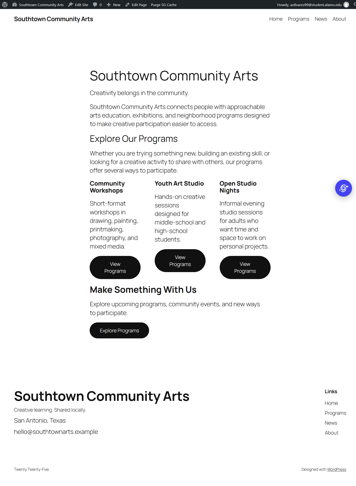
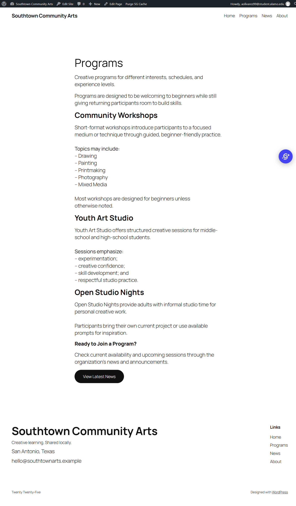
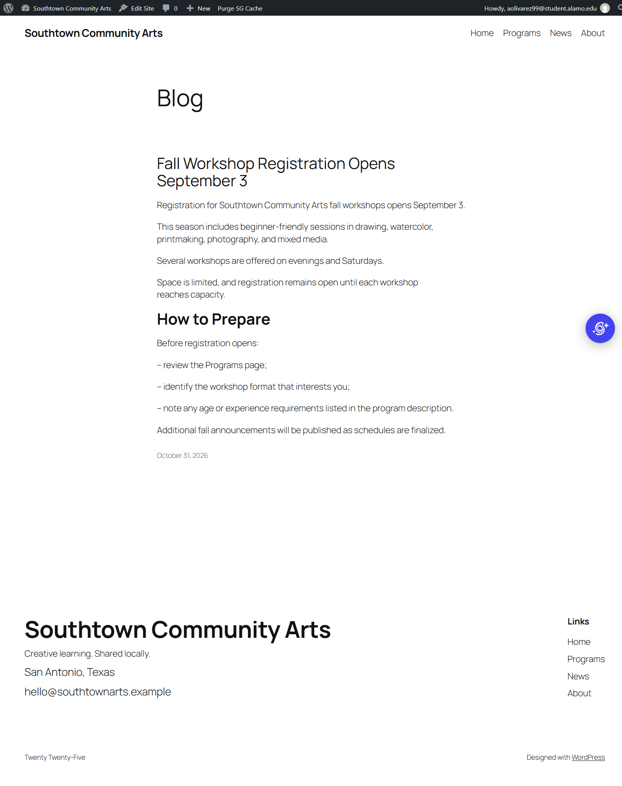
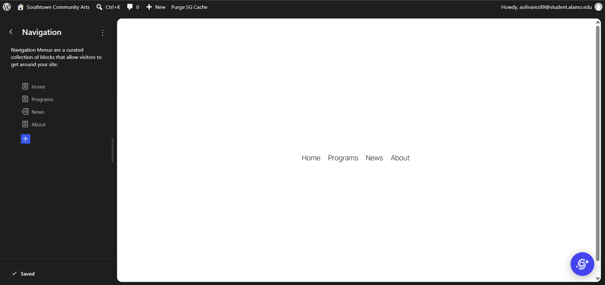
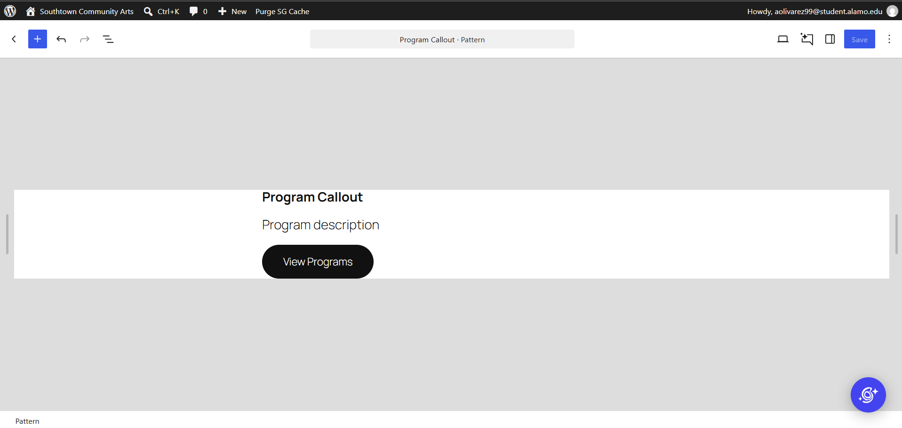
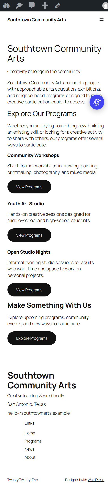

# Week 11: Build for Content — WordPress & CMS Fundamentals

## CMS Project Overview

**Client:** Southtown Community Arts  
**Role:** Junior Web / CMS Specialist  
**Week:** 11 — Build for Content: WordPress & CMS Fundamentals

Briefly summarize what you configured in WordPress.

I created three pages of site content as well as one announcement post. Sitewide navigation and footer sections were updated with proper site links and information.

---

## WordPress Site Access

**Site URL or instructor-access information:**  
[Site Url](https://susane39.sg-host.com/)

---

# Content Architecture

Explain how you organized the supplied client content.

## Pages

List the Pages you created and briefly explain why they belong as Pages.

- **Home:** This page has general content about the organization and should not need regular updates.
- **Programs:** This page has information on the programs provided by the organization and does not need consistent updates if the organization normally has the same programs available.
- **About:** This page has more information about the organization and its values and will not need regular updates if the organization's info remains the same.

## Post

**News Post:** Fall Workshop Registration Opens September 3

Explain why this content belongs as a Post rather than a Page.

The post is an announcement for a specific point in time, meaning the information will not be permanently relevant.

---

# Reusable Pattern

**Pattern Name:**  
Program Callout

**Used For:**  
Small content groups that need a h3 heading title, a small paragraph of information, and a CTA button.

**Why a Pattern Was Appropriate:**  
This structure of content is used multiple times across the website with the only change needed being the text. This means that a pattern can be used for consistent appearance.

---

# Site-Wide Structure

Describe the required Site Editor change you completed.

**Change:**  
I added page links and organization info.

**Where It Was Made:**  
Navigation and footer.

**Why It Belongs at the Site Level:**  
Navigation links should be consistent across pages since it is the primary way a user explores a site, and footer information should be consistent since it contains things such as the organization's contact and other information.

---

# Client Update Test

Complete `CLIENT-UPDATE.md` after the primary site build, then document the result here.

## Supplied Update

Briefly identify the client change you completed.

I applied a small edit to a piece of text on one of the pages.

## Where I Made the Update

What WordPress content-editing area did you use?

I used the page content editor for the programs page.

## Structure Check

Did you need to modify the header, footer, navigation, template, template part, or reusable pattern? Explain.

I did not need to modify anything but the content block itself. I was able to edit the text without affecting any surrounding site content.

## Maintainability Result

Explain how this update demonstrates that routine content can change without rebuilding the site's global structure.

Routine content can be edited without affecting the rest of the site content as long as the content blocks are properly structured in a way that allows you to target only what you need for the update. If an update does not need to be done to global elements, such as the footer, then it can be changed routinely without affecting the rest of the site.

---

# Accessibility & Responsive Checks

Document the quality checks you completed.

## Headings

I kept logical heading structure by choosing specific heading sizes in the proper order of the page hierarchy.

## Images

There were no images provided by the instructor, so I did not add any to the site.

## Links & Buttons

I made sure all links and buttons clearly state their purpose, either indicating the page they link to or having a CTA that clearly communicates what is next for the user.

## Keyboard

I tested keyboard navigation and focus by using the entire website with my keyboard and being sure that everything could be properly navigated with just keyboard interaction.

## Responsive Layout

I checked responsive behavior by looking through the entire site at different viewport widths, making sure that no content was overlapping or improperly positioned.

---

# Evidence

Replace the files in the `evidence/` folder with your own screenshots using the exact required filenames.

## Home Page

## Programs Page

## News Post

## Primary Navigation

## Reusable Pattern

## Narrow-Screen / Mobile View

---

# Developer Handoff

Keep each response concise and specific to this project.

## CMS Choice

Why is WordPress an appropriate solution for Southtown Community Arts?

The website for Southtown Community Arts requires maintaining and updates consistently, making WordPress an appropriate solution. With WordPress the organization can post news and update site information regularly.

## Editable Content

What information should Southtown Community Arts staff be able to update routinely?

Southtown Community Arts staff should be able to routinely update all content on the site. New posts can also be made when the organization has news.

## Reusable Structure

What site element did you make reusable or site-wide, and why?

I made reusable patterns for program callouts and program information, which allowed me to use consistent design for certain elements across the site. The header and footer is also the same site-wide for consistency across pages.

## Client Protection

What design or architecture decision helps the site remain consistent when staff members make routine updates?

Keeping content in appropriate separate blocks ensures that when one item gets edited it does not affect other items. Using reusable patterns also allows multiple elements to have different text content while keeping the same structure and appearance.

## CMS vs Coded Site Reflection

Websites and clients that require consistent updates and changes made to a site are benefitted greatly by a CMS like WordPress. A CMS allows a client to receive a site that is fully created and designed with content to their specifications, and have the ability to easily maintain this site without coding knowledge. A CMS may be unnecessary for a site that does not need regular updates, and using a CMS may have the tradeoffs of design limitations or plugin updates breaking the site, whereas a hand-coded static site does not have these problems.

---

# Final Handoff Check

- [x] Home, Programs, and About are published as Pages.
- [x] The supplied announcement is published as a Post.
- [x] Primary navigation works in the required order.
- [x] One meaningful reusable Pattern is present.
- [x] The required site-wide structure adjustment is complete.
- [x] I completed the supplied `CLIENT-UPDATE.md` request after the main build.
- [x] The client update did not require unnecessary global-structure changes.
- [x] Headings are logical.
- [x] Informative images have meaningful alternative text.
- [x] Link and button labels are understandable.
- [x] Keyboard focus is visible.
- [x] Narrow-screen behavior was checked.
- [x] All six evidence images display correctly in this README.
- [x] All four Developer Handoff responses are complete.
- [x] I committed and pushed this Week 11 handoff folder.
