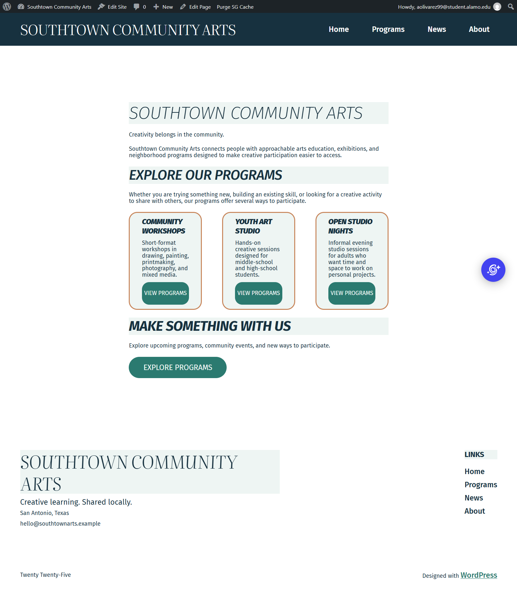
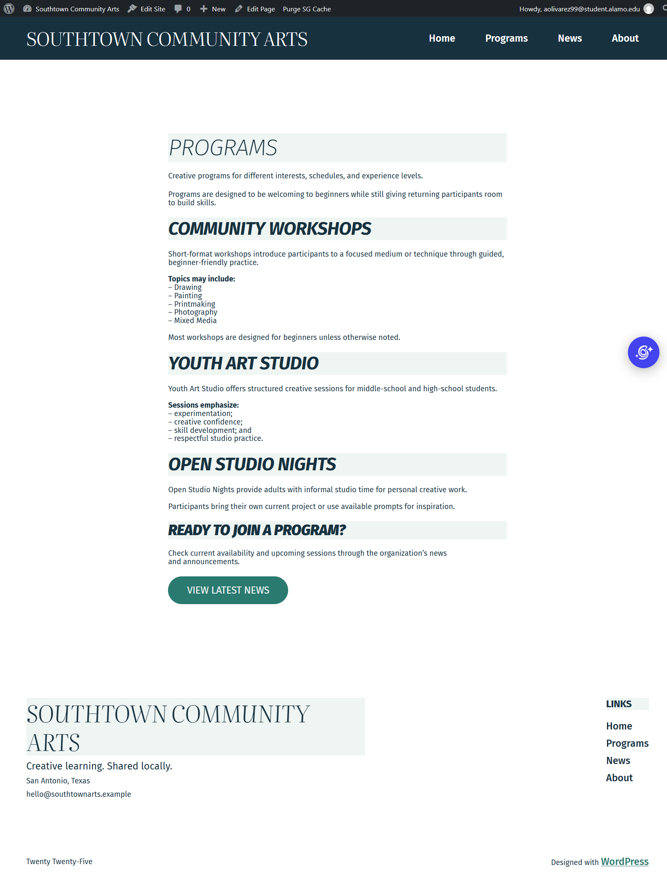
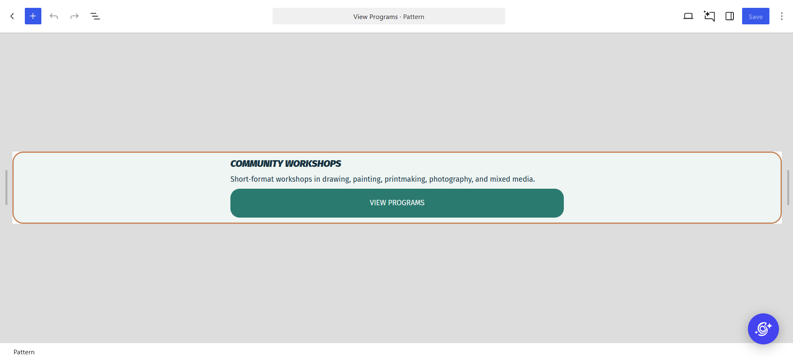
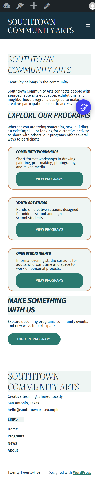
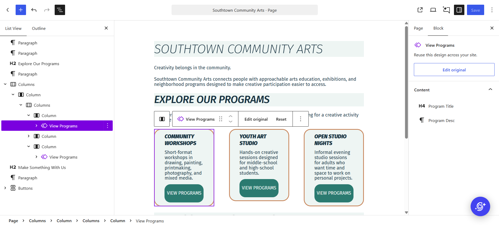

# Week 12: Customize the Experience — WordPress Development

**Client:** Southtown Community Arts  
**Role:** Junior WordPress Developer

## Project Overview

Briefly summarize how you customized the existing Week 11 CMS without making routine content harder for the client to maintain.

Content was customized without making it harder to maintain by using reusable patterns and the site editor. This kept most of the appearance customization to systems separate than the one used for editing or creating new site content.

---

## WordPress Site Access

**Site URL:**  
[Site Url](https://susane39.sg-host.com/)

# Customization Decisions

Document the four required decisions below.

## 1. Global Design System

**Requirement:**  
Palette and typography

**Location:**  
Global styles

**Change:**  
I changed the palette of the theme and the typography of elements

**Why this level:**  
This global solution was better than editing pages manually since the appearance has to be consistent across the site, so having changes applied globally is a better solution.

**QA:**  
I tested color contrast, layout across multiple pages, and site responsiveness.

---

## 2. Branded Reusable Pattern

**Pattern:**  
View Programs

**Change:**  
I used a different background color, a border color around the pattern, and different font sizes.

**Reuse:**  
I used the pattern for multiple program cards on the home page.

**Editor value:**  
This keeps a consistent design for the program cards with text that can be easily edited.

---

## 3. Site-Wide Structure Customization

**Shared area:**  
Header

**Change:**  
Background color, font color, and the navigation submenu appearance

**Why this level:**  
This change belonged in the shared site structure since the header is present on every page and should look the same across pages.

**QA:**
I checked every page

---

## 4. Controlled Development-Level Modification

Complete **one** option.

**Option used:**  
theme.json

**Location:**  
Buttons text color and background color on hover

**Code / configuration snippet:**

```
"color": {
            "background": "var(--wp--preset--color--custom-southtown-soft)",
            "text": "var(--wp--preset--color--custom-southtown-teal)"
          }
```

**Reason:**  
Keeping the consistent brand palette could not be solved cleanly with the available editors due to buttons having different colors when hovered that could only be edited through theme.json.

**Documentation:**  
https://developer.wordpress.org/themes/global-settings-and-styles/introduction-to-theme-json/

**QA:**  
I tested the site layout, responsiveness, and content editor after making the change to ensure there was no issues.

---

# Visitor + Editor QA

## Visitor Experience

- [x] I tested narrow and wide viewport behavior.
- [x] I checked visual consistency on more than one page.
- [x] I checked text/link/button contrast.
- [x] I verified visible keyboard focus.
- [x] I tested navigation and links.
- [x] I checked that the brand system is consistent rather than page-specific.

### Visitor QA Notes

While editing the header, there was a brief issue with the navigation submenu that appears at small screen widths. The change of the text color made it blend in with the background color due to the submenu style options being within the navigation block of the header, so I had to go back and fix this.

## Editor Experience

- [x] Routine content is still editable through WordPress.
- [x] The branded pattern is understandable to reuse/edit.
- [x] My customization did not move ordinary client content into code.
- [x] I performed one temporary routine content edit, previewed it, and restored the original content.
- [x] The site remained visually coherent after the editor test.

### Editor QA Notes

I tested editing the text content of the headings, plain text, and branded pattern to ensure the styling did not get in the way of easily upating content.

---

# Evidence

Use the exact filenames below.

## Customized Home



## Customized Programs



## Branded Reusable Pattern



## Responsive / Mobile View



## Editor Maintainability Test



---

# Maintainability Reflection

Write approximately **75–100 words** responding to:

> Give one example of a change you intentionally handled globally and one change you intentionally left as editable content. How does that separation help Southtown Community Arts maintain the site without losing design consistency?

One change that was handled globally was the brand approved color palette in the style editor, and one change that was left as editable content was the reusable View Programs cards. This separation allows Southtown Community Arts to maintain the site with design consistency by keeping important brand content, such as the associated color palette, to settings that apply across the entire site. Meanwhile, the reusable pattern has editable text content so that information and CTAs can be changed on an editor level. Having these two types of things separated generally helps maintain consistency by keeping style editing decisions outside of the content editor.

---

# Final Handoff Check

- [x] I continued the Week 11 Southtown site rather than rebuilding it.
- [x] I applied the approved palette and typography direction systematically.
- [x] I used global controls for global decisions.
- [x] I created or significantly customized one branded reusable pattern.
- [x] I made one appropriate site-wide structure customization.
- [x] I completed exactly one controlled development-level modification.
- [x] I did not add PHP, plugins, custom blocks, or a child-theme build for this assignment.
- [x] Visitor and editor QA are complete.
- [x] All five evidence screenshots display in this README.
- [x] I completed the maintainability reflection.
- [x] I committed and pushed the Week 12 handoff folder.
